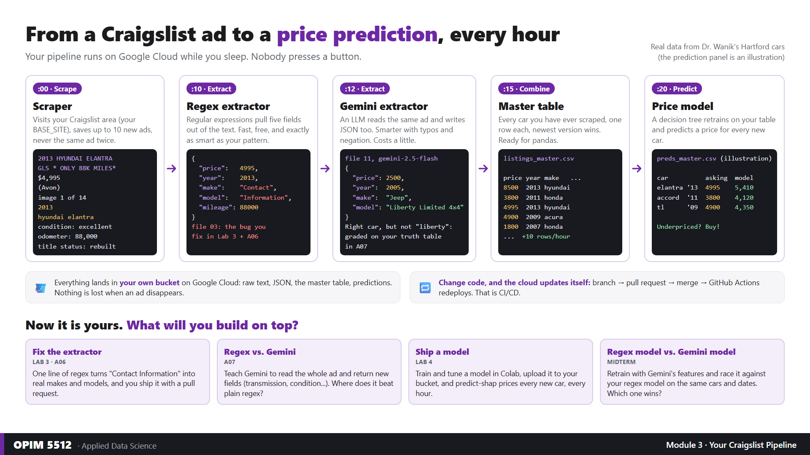

# Lab 4: Deploying Your Model to Production · **START HERE**

> Hartford: **Wed Oct 14** · Stamford: **Wed Oct 21** · Submit by **Thu Oct 22, 11:59 PM** (both campuses).



**Solo · about 2 hours · Colab · Dr. Wanik's cleaned Hartford cars, then your own Google Cloud bucket.** Your pipeline
scrapes, extracts and combines cars every hour. Tonight you **fit a really good model** (tuned, and better than the
baseline) and **deploy it** into that pipeline, so it prices every new car on its own, every hour (and saves why, with SHAP).

| | What | Link |
|---|---|---|
| 🚀 | **The lab notebook** (open in Colab, then File → Save a copy in Drive) | [Lab4_Model_In_Production.ipynb](https://colab.research.google.com/github/drdave-teaching/OPIM5512-notebooks/blob/main/Module3/Lab4_Model_In_Production.ipynb) |
| 🗺️ | **Tonight in 20 steps** (print it, or keep it on a second screen) | [OPIM5512_Lab4_20_Steps_PRINT.pdf](handouts/OPIM5512_Lab4_20_Steps_PRINT.pdf) |
| ☁️ | **Final GCP Guide F26** (if your pipeline is not running yet) | [FINAL_GCP_Guide_F26.ipynb](https://colab.research.google.com/github/drdave-teaching/OPIM5512-notebooks/blob/main/Module3/FINAL_GCP_Guide_F26.ipynb) |
| 🧠 | **The production function** your model runs inside | [`cloud_function/predict-shap/main.py`](https://github.com/drdave-teaching/myscrapers/blob/main/cloud_function/predict-shap/main.py) |
| 📊 | **The training data** (453 Hartford cars, Sep 28 to Oct 13, after the A06 regex fix) | [lab4_listings_master_snapshot.csv](https://github.com/drdave-teaching/OPIM5512-notebooks/blob/main/Module3/data/lab4_listings_master_snapshot.csv) |

## Before class (10 minutes, please)

Get **`predict-shap`** deploying before you arrive: it takes about 3 minutes. Open your myscrapers repo on GitHub and
find your case (Part 0 of the notebook has every step and command):

| What you see on your repo's Code tab | Do this |
|---|---|
| "This branch is N commits **behind** drdave-teaching/myscrapers" | **A:** Sync fork → **Update branch** (never "Discard commits") |
| "forked from drdave-teaching/myscrapers", 0 behind, and a `cloud_function/predict-shap` folder | **B:** Actions → **Deploy predict-shap** → **Run workflow** |
| No "forked from drdave-teaching/myscrapers" under the repo name | **C:** paste the Cloud Shell block from Part 0 |

- [ ] **Deploy predict-shap** shows a green check (A or B), or the Cloud Shell block finished (C)
- [ ] Your **A06 regex fix** is shipped (otherwise half your makes say `contact`)
- [ ] You know your **project ID** and **bucket name** (usually the same)
- [ ] **2-step verification is on** for your Google Cloud Gmail. Since Oct 13, Google Cloud may show a "Turn on 2-step verification" box and can lock you out of the console without it: click **Enable MFA** (or turn it on later at myaccount.google.com → Security), not just "Remind me later"

## Tonight in 8 parts

| Part | Time | You do |
|---|---|---|
| 0. Before you start | 5 min | Get `predict-shap` deploying (case A, B or C) |
| 1. Load | 10 min | Dr. Wanik's cleaned cars, same versions as production (scikit-learn 1.6.1, shap 0.48.0) |
| 2. Clean | 10 min | `Ford` vs `ford`, `chevy` vs `chevrolet`, flag junk rows (odd price, placeholder mileage) |
| 3. Baseline | 10 min | The numbers to beat: guess the median, and the decision tree your pipeline already trains |
| 4. Tune | 25 min | Tune a decision tree, a random forest and KNN with cross-validation. **You pick the champion** |
| Your turn | 15 min | **You code it:** actual-vs-predicted scatter, error histogram and summary stats, champion vs baseline |
| 5. Explain | 20 min | SHAP on your champion, then **price a car you know** and see why |
| 6. Ship | 20 min | Save the model + model card, upload to your bucket (your account is checked first), run `predict-shap` right from Colab |
| 7. Your model at work | 5 min | What your frozen model priced in the cloud (open the two CSVs yourself), and why one price |
| 8. Wrap up | 5 min | Five short answers, submit |

## Where everything lives in your bucket

```
models/model.joblib, model_card.json     your LIVE model (the newest upload; predict-shap reads only this)
models/history/model_<time>.joblib       a copy of every model you ever shipped, named by time (never overwritten)
structured/datasets/listings_master.csv  all your cars (the scraper adds ~10 an hour)
structured/preds_lab4/preds_master.csv   every price your model made, tagged with the model version that made it
structured/preds_lab4/shap_master.csv    the SHAP values behind each of those prices
structured/preds/                        the pipeline's background decision tree (train-dt): ignore it for Lab 4
```

**Your model is frozen**: production never retrains it. Retraining = run the notebook again and upload; production
switches to the new model by itself, and the old predictions stay, tagged with the old version.

**Submit:** HuskyCT → *Submit Lab 4* (upload your `.ipynb`), due **Thu Oct 22, 11:59 PM** (Hartford and Stamford).

**Leave `predict-shap` running.** Every hour at :25 it predicts and explains your newest cars, and your midterm can
chart how your model's errors and explanations move over time.

## Stuck?

Ask Claude: paste the cell, the **full** error, and what you expected. Most problems are one of these:
- **Wrong Google account** in the Colab pop-up: pick the Gmail you used for Google Cloud. Part 6c prints "Signed in as ..." and stops with a clear message if that account cannot see your bucket.
- **`status: no_model`** from `predict-shap`: your upload in Part 6c did not run (check `PROJECT_ID` and `BUCKET_NAME` in Part 1b).
- **Part 7 says your model priced exactly 500 cars**: you have more than 500 in your bucket. Production prices at most 500
  per run (40 for KNN); the rest get priced at the next hourly :25 runs. Training is not limited: it uses every car you load.
- **Part 7 says "No production predictions yet"**: run Part 6d (it starts `predict-shap` from Colab and waits for it), then re-run the cell.
